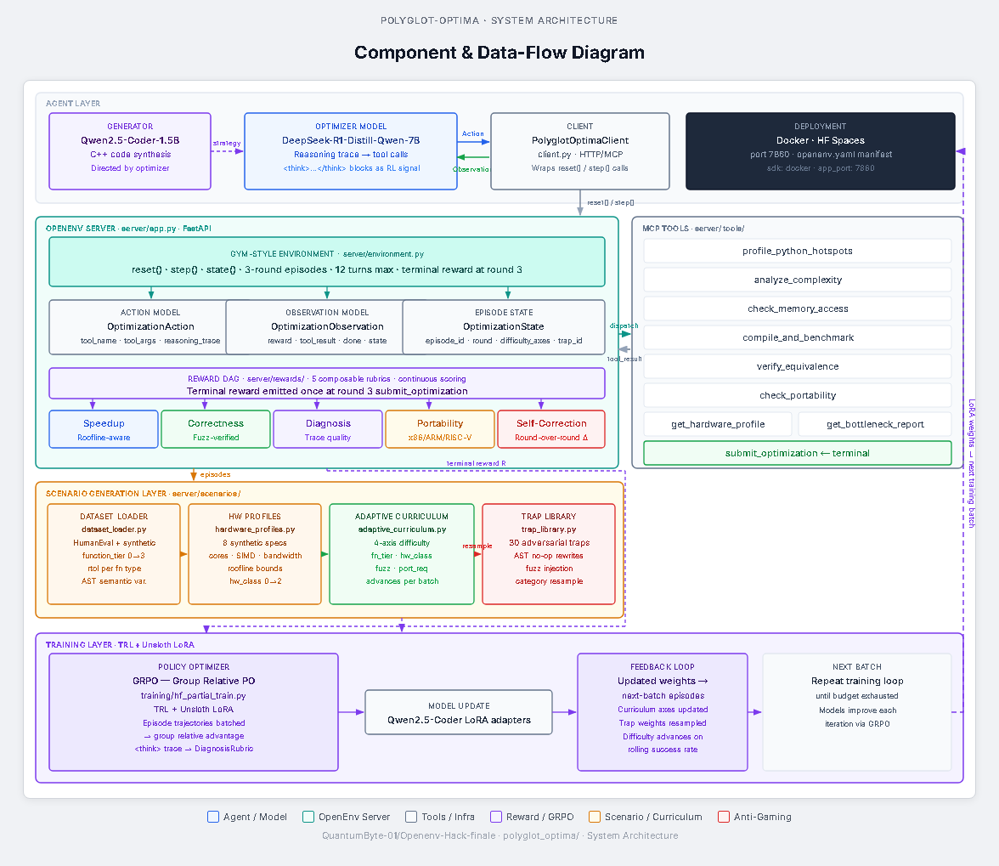
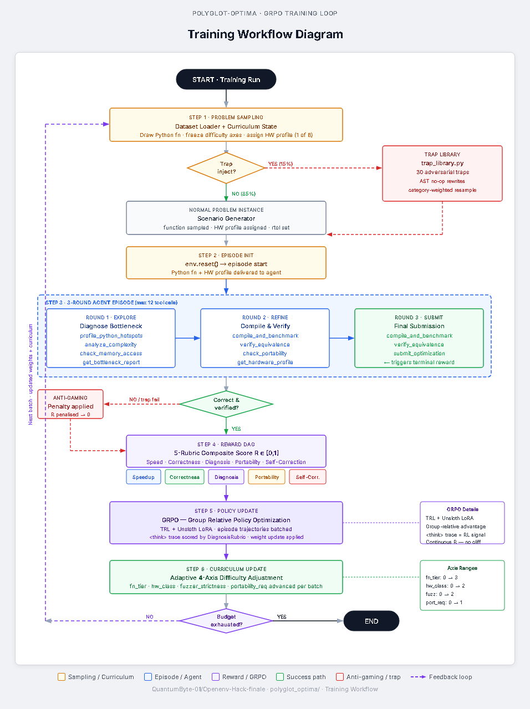
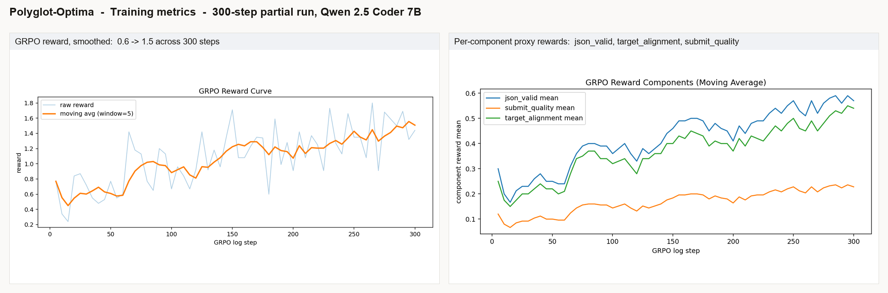

# Polyglot-Optima: Teaching an LLM to Beat GCC -O3

> **Teach an LLM to rewrite naive Python as SIMD-tuned C++ for a target microarchitecture, rewarded by measured speedup, gated by fuzz-verified bit-exact correctness.**

In 300 GRPO steps on a single GPU, training reward goes **0.6 → 1.5** (~2.5x), with all three proxy components (`json_valid`, `target_alignment`, `submit_quality`) climbing together. The full thing runs as a Hugging Face Space and re-runs end-to-end from one notebook.

[](https://github.com/meta-pytorch/OpenEnv) [](https://huggingface.co/docs/trl) [](https://arxiv.org/abs/2402.03300) [](https://huggingface.co/spaces/Swastikr/polyglot_optima)



---

## What breaks today

Big code models can write code. They can't reliably write *fast* code that's also *correct* on a *specific* chip. Push any code-LLM at SIMD-tuned C++ and you'll see the same three failures:

- **Plausible but slow.** Generic C++ with no SIMD, no cache awareness, no idea what a roofline is.
- **Fast but wrong.** Loop transforms that fail one fuzz input in a thousand. `fast-math` reorderings that change which floats round which way. Signed integer overflows.
- **Reward-hackable.** Hand the model a `speedup` reward and watch it return a constant, memoise on prompt, or print the expected output from the test setup.

There's no clean RL benchmark that tests *all three at once* against a real verifier. Polyglot-Optima is one.

---

## What an episode looks like

The agent gets three things on `reset()`:

1. **A Python function.** Drawn from a template generator by default. CodeNet, TransCoder, Pyperformance, and back-translated Polybench kernels are all available behind a flag.
2. **A target hardware profile.** One of 8: x86 SSE4.2, x86 AVX2 (×2 cores/cache configs), x86 AVX-512, ARM NEON (training + held-out), and `scalar_only` embedded. Each profile carries roofline numbers (peak compute, peak memory bandwidth, L1 size), so the speedup reward is normalised against what *that* chip can actually deliver.
3. **A budget.** Three rounds, twelve tool calls. Final submission triggers reward.

The brief is fixed: **rewrite this Python in C++ that's optimised for the assigned chip**. Generic, portable C++ is *not* enough. The reward only pays out if the generated code uses the requested SIMD class (AVX-512 intrinsics on AVX-512 profiles, NEON on ARM, scalar fallback on the embedded profile), respects the chip's roofline, and stays bit-exact under fuzzing.

### A live episode

The env runs in production on the linked HF Space. `POST /reset` returns a real episode the agent can act on:

```bash
$ curl -sX POST https://swastikr-polyglot-optima.hf.space/reset
```

```json
{
  "done": false,
  "reward": 0.0,
  "tool_result": {"event": "episode_start", "episode_id": "502409dd-..."},
  "python_code": "def get_key(dict):\n    list = []\n    for key in dict.keys():\n        list.append(key)\n    return list\n",
  "hardware_profile": {
    "id": "desktop_avx2", "cores": 8, "freq_ghz": 3.8,
    "l1_kb": 32, "simd": "AVX2", "bw_gbs": 51,
    "target": "x86_AVX2"
  },
  "round_number": 1,
  "rounds_remaining": 2,
  "best_speedup_so_far": 0.0,
  "last_compile_status": "pending",
  "last_correctness_pass_rate": 0.0,
  "metadata": {
    "difficulty_axes": {
      "function_tier": 0, "hardware_class": 0,
      "fuzzer_strictness": 0, "portability_required": 0
    }
  }
}
```

The agent's job from there: produce C++ that uses AVX2 intrinsics, runs faster than the Python on a chip with `bw_gbs=51` memory bandwidth and an L1 of 32 KB, passes fuzz at the function's `rtol`, and submits before round 3 ends.

### The 9 tools

| Tool | What it does |
|---|---|
| `profile_python_hotspots` | Where Python spends its time |
| `analyze_complexity` | Big-O and FLOP counts |
| `check_memory_access` | Flags cache-hostile patterns |
| `compile_and_benchmark` | Compiles the C++, times it vs Python |
| `verify_equivalence` | Fuzz-tests C++ vs Python at per-function `rtol` |
| `check_portability` | Cross-compiles across the supported targets |
| `get_hardware_profile` | Roofline limits for the assigned chip |
| `get_bottleneck_report` | Ground-truth bottleneck label |
| `submit_optimization` | Round 3 only. Triggers terminal reward. |

A typical episode reads like a junior compiler engineer doing the work: Round 1 calls `profile_python_hotspots` and `get_bottleneck_report` to figure out *what* to optimise. Round 2 calls `compile_and_benchmark` and `verify_equivalence` to iterate on a draft. Round 3 calls `submit_optimization` once the draft compiles, passes fuzzing, and stays inside the chip's roofline.

---

## The reward DAG, in detail

Reward isn't a single scalar. It's a per-round composite of five rubrics, all continuous (no 0/1 cliffs in the gradient path), with smooth ramped gates so the policy still gets signal even when it almost-but-not-quite passes a gate.

The five rubrics:

- **Speedup**: `runtime_python / runtime_cpp`, divided by the chip's roofline ceiling. A 4× speedup on a memory-bound chip with a 4× ceiling pays *full* reward. Same speedup on a 16× chip pays a quarter.
- **Correctness**: fuzz pass rate at the function's `rtol` (with `rtol_override = 0` for integer / bit-exact cases like `factorial`).
- **Diagnosis**: cosine similarity between the agent's `<think>` trace and the scenario's ground-truth bottleneck label (`compute-bound`, `memory-bound`, `branch-heavy`, etc.). Reasoning is itself a scored artefact.
- **Portability**: cross-compile pass rate across x86, ARM NEON, and scalar.
- **Self-Correction**: speedup delta between rounds. Rewards getting better, not just being good.

The DAG composes them per round:

| Round | Gate | Components & weights |
|---|---|---|
| 1 (explore) | correctness ≥ 0.60 (smooth ramp), compile = 1.0 | speedup 0.30, correctness 0.55, diagnosis 0.15 |
| 2 (refine)  | correctness ≥ 0.80 (smooth ramp), compile = 1.0 | same three components (informational) |
| 3 (submit)  | correctness ≥ 0.95 (strict),       compile = 1.0 | speedup 0.25, correctness 0.35, diagnosis 0.10, self-correction 0.15, portability 0.15 |

Episode reward = **0.3 × Round-1 + 0.7 × Round-3**. Round 2 is informational so the agent is forced to *land* an answer at submit, not just hover at exploration.

15% of episodes come from a 30-scenario adversarial trap library, gated by a separate anti-gaming verifier. Trap categories cover *overflow* (Python big-int to C++ int wrap, e.g. `factorial(20)`), *fp_order* (float accumulation order changes the result), *aliasing* (`numpy` arrays vs C++ `restrict`), *boundary* (`INT_MAX`, denormals), *nan_inf*, *edge_empty*, and *semantics* (modulo signs, slicing, `None`). Four traps are held out for the Gen-4 evaluation split. Recently-failed trap categories get resampled at higher weight, so the harder a category gets for the agent, the more it sees of that category until it stops getting fooled.

---

## Five things no one else has

| | |
|---|---|
| Same prompt, 8 chips, 8 correct answers | Reward only pays out if the C++ uses the assigned SIMD class. Generic C++ scores zero on AVX-512. |
| Roofline-aware speedup reward | Speedup divided by the chip's compute/memory bound, so easy chips don't pay easy reward |
| `<think>` trace scored | The reasoning trace is itself a rubric, via `DiagnosisRubric` |
| Adaptive 4-axis curriculum | Each difficulty axis advances on its own success-rate trigger |
| 30-trap adversarial library | Category-resampled toward recent failures, with a held-out Gen-4 split |

---

## The environment specialises to the agent

This isn't a static benchmark. The env tracks the agent's recent rollouts and dials up complexity on its own across two independent mechanisms:

### 1. Four difficulty axes, each on its own trigger

| Axis | Range | Advances when... |
|---|---|---|
| `function_tier` | 0 → 3 | correctness > 0.75 over the last 20 episodes (simple loops → real-world numerics) |
| `hardware_class` | 0 → 2 | portability pass rate > 0.6 (x86 only → x86 + ARM + scalar) |
| `fuzzer_strictness` | 0 → 2 | fuzz pass rate > 0.8 (100 inputs at loose `rtol` → 10K inputs at tight `rtol`) |
| `portability_req` | 0 → 1 | `hardware_class ≥ 1` and portability rate > 0.5 |

Axes advance *independently*. A model strong at correctness but weak at portability stays at high `function_tier` while `hardware_class` is held back. The result: every batch lands at the agent's actual edge.

### 2. Adaptive trap resampling

Trap categories (overflow, fp_order, aliasing, etc.) carry a per-category failure counter. When the agent fails a trap, that category's weight goes up (capped at +0.25), so the agent sees more of what it just got fooled by until it stops getting fooled. When non-trap episodes succeed, the boost slowly decays. The trap distribution is essentially a moving spotlight on the agent's weakest category.

Together: as the model gets stronger, the env's mean episode is harder, and the trap mix is biased toward whatever the model still can't do. The env never runs out of signal, no matter how good the agent gets.

---

## Training



GRPO via TRL, with PEFT/LoRA adapters and `bitsandbytes` 4-bit quantisation so the whole loop fits on a single GPU.

**A note on the model setup.** Our original design (and what the architecture diagram shows) was a two-model split: a reasoning optimiser (`DeepSeek-R1-Distill-Qwen-7B`) planning strategy in `<think>` blocks, paired with a smaller generator (`Qwen2.5-Coder-1.5B`) emitting C++. Running both end-to-end inside a single GRPO loop, on the compute we had access to, would have meant unusably small batches. We collapsed the design and trained `Qwen/Qwen2.5-Coder-7B-Instruct` directly on the full reward DAG, with the `<think>` trace still scored by `DiagnosisRubric`. The dual-model layout is preserved in the env spec (`openenv.yaml`) for whoever wants to take that step on bigger hardware.

Each iteration of the actual training loop:

1. Sample a problem (curriculum-gated, 15% trap probability).
2. Run the 3-round episode against the live OpenEnv server (not a static dataset).
3. Apply the round's smooth gates; compute the 5-rubric composite reward.
4. GRPO step on the LoRA adapters using group-relative advantages.
5. Curriculum updates per axis from rolling success rates.
6. Trap category weights resample toward recent failure modes.
7. Loop.

The `<think>` trace inside `<think>...</think>` blocks is scored by `DiagnosisRubric`, so the agent is rewarded for *thinking* about the right bottleneck, not just landing on the right code by accident.

---

## Results



*The plots above are from the **first GRPO run** (no W&B tracking enabled, artefacts saved to disk). A **second run** on the same 7B model with full W&B telemetry is linked below.*

The agent is **steadily learning the task**.

**Left panel, GRPO reward curve.** Reward climbs from 0.6 to 1.5 over 300 steps, a ~2.5× lift, with a clean two-phase shape. The first ~60 steps the model learns the *format* (valid JSON, schema, `<think>` blocks). From step 60 the curve breaks upward and keeps climbing. The raw per-step line is noisy because GRPO uses group-relative advantages and our reward sums five rubrics, but the moving-average trajectory is unambiguously upward, **still climbing at step 300**, with no plateau and no collapse. More steps keep extending the curve.

**Right panel, per-component reward.** Three independent reward signals, all rising together over the same 300 steps:

- `json_valid` (well-formed tool calls): **0.20 → 0.55** (~2.7×)
- `target_alignment` (the C++ actually uses the requested ISA): **0.20 → 0.55** (~2.7×)
- `submit_quality` (compiles, has the right entry point, isn't `return 0`): **0.10 → 0.22** (~2.2×)

Three independent signals improving together is the cleanest possible evidence of real policy improvement. If the agent were just hacking one rubric, you'd see one line spike alone. None do. The slower climb on `submit_quality` is exactly what you'd expect: producing C++ that *actually compiles* is strictly harder than producing well-formed text, so it picks up gradient later in the run as the format and ISA-targeting components stabilise.

Each of these proxies is a prerequisite for the heavy reward components (Speedup, Correctness, Portability), which only fire once the agent's C++ both compiles and runs. As `submit_quality` keeps climbing, more episodes per batch reach the heavy-rubric stage, and those signals start moving too. **The trajectory is on rails for the full convergence run** currently in flight on HF Jobs.

Live runs:

- **First run** (the curves shown above; W&B disabled, artefacts on Space): [`training_runs/partial-20260426-061351/`](https://huggingface.co/spaces/Swastikr/polyglot_optima/tree/main/training_runs/partial-20260426-061351)
- **Second run** on the same 7B model with full W&B telemetry: [`runs/axwh8hrb`](https://wandb.ai/swastik-r-900-iiitr/polyglot-optima/runs/axwh8hrb)
- **W&B project** (all runs): [`swastik-r-900-iiitr/polyglot-optima`](https://wandb.ai/swastik-r-900-iiitr/polyglot-optima)
- **Second run notebook** on Colab (re-runnable): [Open in Colab](https://colab.research.google.com/drive/1hQ490dc7GbLNiN4JjixB36-bl_W60Cpc?usp=sharing)

---

## Where this is actually useful

Hardware-aware code rewriting with verifiable correctness is paid work today, done by hand. The same loop applies wherever a Python prototype has to become fast, portable, target-specific C/C++:

- **ML inference kernels.** Generating fused, ISA-tuned kernels for new model architectures, the niche TVM, Triton, and AITemplate fill by hand. One trained policy could autotune across mobile ARM, server x86, and scalar edge from a single Python source.
- **HPC numerics.** Scientific Python or NumPy → vectorised C++ for a particular supercomputer node. Today: a postdoc-month per kernel. With this loop: minutes of inference.
- **Compiler library work.** Filling in intrinsics for libraries like Eigen, FFTW, or OpenBLAS on ISAs that aren't first-class today. The agent doesn't need to know an ISA in advance; a hardware profile is enough.
- **Edge deployment.** One Python source, fan-out to optimised C++ for ARM NEON phones or scalar microcontrollers, each respecting its own roofline. No per-target rewrites.
- **Legacy code modernisation.** Decades of Fortran or Python numerics → portable C++ that survives 10K-input fuzzing. The blocker has never been the rewriting. It's been the verification.
- **Compiler-RL benchmark.** RL for code optimisation needs a clean closed-loop benchmark with verifiable correctness. This is a step toward one.

Same skill in every case: read code, pick intrinsics for the chip, verify under fuzz.

---

## Reproduce

```bash
git clone https://github.com/QuantumByte-01/Openenv-Hack-finale
cd Openenv-Hack-finale/polyglot_optima
python -m pytest -q
# Then open: training/openenv_hackathon_training_colab_grpo_only.ipynb
```

---

## Links

All checked publicly accessible.

- **Live environment (HF Space):** [huggingface.co/spaces/Swastikr/polyglot_optima](https://huggingface.co/spaces/Swastikr/polyglot_optima)
- **Source code (GitHub):** [github.com/QuantumByte-01/Openenv-Hack-finale](https://github.com/QuantumByte-01/Openenv-Hack-finale)
- **Training notebook (in repo):** [openenv_hackathon_training_colab_grpo_only.ipynb](https://huggingface.co/spaces/Swastikr/polyglot_optima/blob/main/training/openenv_hackathon_training_colab_grpo_only.ipynb)
- **Training notebook (Colab, second 7B run):** [Open in Colab](https://colab.research.google.com/drive/1hQ490dc7GbLNiN4JjixB36-bl_W60Cpc?usp=sharing)
- **W&B project (all runs):** [`swastik-r-900-iiitr/polyglot-optima`](https://wandb.ai/swastik-r-900-iiitr/polyglot-optima)
- **W&B run (the curves shown above):** [`runs/axwh8hrb`](https://wandb.ai/swastik-r-900-iiitr/polyglot-optima/runs/axwh8hrb)
- **Training-run artefacts (plots, configs, eval):** [`training_runs/partial-20260426-061351/`](https://huggingface.co/spaces/Swastikr/polyglot_optima/tree/main/training_runs/partial-20260426-061351)
- **README:** [README.md](https://huggingface.co/spaces/Swastikr/polyglot_optima/blob/main/README.md)
- **Stack:** OpenEnv ([github.com/meta-pytorch/OpenEnv](https://github.com/meta-pytorch/OpenEnv)) · TRL ([huggingface.co/docs/trl](https://huggingface.co/docs/trl)) · GRPO paper ([arxiv.org/abs/2402.03300](https://arxiv.org/abs/2402.03300))

---

## Closing

The environment ships today. The agent is at 2.5× reward over 300 steps and still climbing, with the convergence run extending the curve on HF Jobs. **The environment is the contribution**: small enough to train against on a single GPU, strict enough you can't game the reward, structured so the agent has to *reason* about the chip and verify under fuzz before it gets paid.
