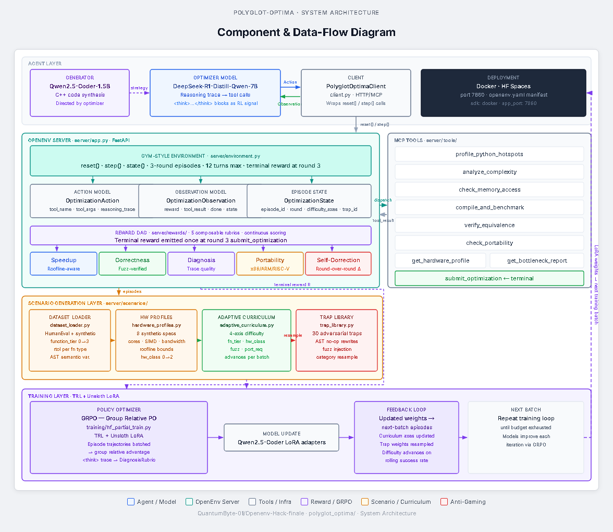
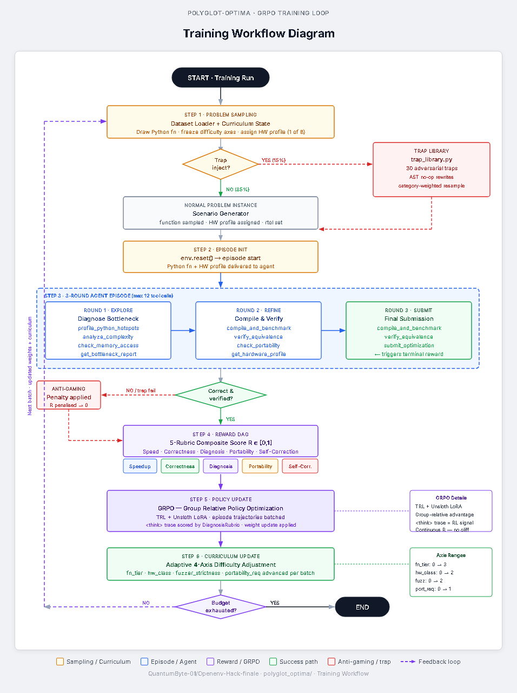
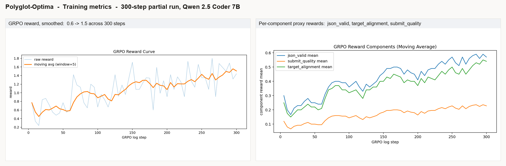

# Polyglot-Optima

An OpenEnv environment that trains a reasoning LLM to rewrite naive Python into hardware-aware, fuzz-verified C++. Rewarded by **measured speedup**, gated by **bit-exact correctness**, stress-tested by a **30-scenario adversarial trap library**.

🟢 **Live environment (Hugging Face Space):** [huggingface.co/spaces/Swastikr/polyglot_optima](https://huggingface.co/spaces/Swastikr/polyglot_optima)
📝 **Full blog write-up:** [HF_BLOG_WRITEUP.md](HF_BLOG_WRITEUP.md)

---

## Quickstart

### 1. Hit the deployed Space

```bash
curl https://swastikr-polyglot-optima.hf.space/health
# {"ok": true, "env": "polyglot-optima", ...}
```

### 2. Run locally (Docker)

```bash
git clone https://github.com/QuantumByte-01/polyglot-optima
cd polyglot-optima/polyglot_optima
docker build -t polyglot-optima .
docker run -p 7860:7860 polyglot-optima
# server up at http://localhost:7860
```

### 3. Run locally (Python, no Docker)

```bash
git clone https://github.com/QuantumByte-01/polyglot-optima
cd polyglot-optima/polyglot_optima
pip install -e .
python -m server.app   # uvicorn on port 7860
```

### 4. Train against it

Open the notebook and run all cells (works on Colab, Kaggle, or HF Jobs):

```
training/openenv_hackathon_training_colab_grpo_only.ipynb
```

Defaults: `Qwen/Qwen2.5-Coder-7B-Instruct`, 4-bit `bitsandbytes`, PEFT/LoRA, GRPO via TRL.

### 5. Smoke-test the LLM tool loop

```bash
python tests/smoke_llm_hf.py
```

### 6. Run the test suite

```bash
python -m pytest -q
python -m ruff check .
```

### Environment variables

Template at `.env.example`. None are required for local notebook execution.

- `HF_TOKEN`: only needed when uploading to HF Hub / Space
- `WANDB_API_KEY`: only needed for experiment tracking

---

## Why this problem

Big code models can write code. They can't reliably write *fast* code that's also *correct* on a *specific* chip. Push any code-LLM at SIMD-tuned C++ and you'll see the same three failures:

- Generic C++ with no SIMD and no awareness of cache lines or roofline.
- Loop transforms that look right but fail one fuzz input in a thousand.
- Hand it a `speedup` reward and it returns a constant.

There's no clean RL benchmark for hardware-aware code optimisation with verifiable correctness. Polyglot-Optima is our attempt at one.

---

## How the environment works

Each episode hands the agent:

- A **Python function** (template generator by default; CodeNet / TransCoder / Pyperformance / back-translated Polybench available behind a flag).
- A **target hardware profile** (one of 8: x86 SSE4.2 / AVX2 / AVX-512, ARM NEON, scalar-only embedded).
- A budget of **3 rounds, 12 tool calls**.

The brief: rewrite this in C++ for this chip. Final submission triggers reward.

### 9 MCP tools

| Tool | What it does |
|---|---|
| `profile_python_hotspots` | Where Python spends its time |
| `analyze_complexity` | Big-O and FLOP counts |
| `check_memory_access` | Flags non-contiguous / cache-hostile patterns |
| `compile_and_benchmark` | Compiles the C++ and times it vs Python |
| `verify_equivalence` | Fuzz-tests C++ vs Python at per-function `rtol` |
| `check_portability` | Cross-compiles across the supported targets (x86 / ARM / scalar) |
| `get_hardware_profile` | Roofline limits for the assigned chip |
| `get_bottleneck_report` | Ground-truth bottleneck label |
| `submit_optimization` | Round 3 only. Triggers terminal reward. |

### 5-rubric reward DAG

- **Speedup**: measured runtime ratio, normalised by the chip's roofline.
- **Correctness**: fuzz pass rate at the function's `rtol`.
- **Diagnosis**: cosine similarity between the agent's `<think>` trace and the ground-truth bottleneck label.
- **Portability**: cross-compile pass rate across x86, ARM NEON, and scalar.
- **Self-Correction**: speedup delta between rounds.

Rounds use smooth ramped gates (correctness ≥ 0.60 / 0.80 / 0.95). Episode reward = `0.3 × Round-1 + 0.7 × Round-3`. 15% of episodes are adversarial traps; their reward is zero unless a separate anti-gaming verifier passes.

### Adaptive 4-axis curriculum

Difficulty turns up as the agent improves, each axis on its own success-rate trigger:

| Axis | Range | Advances when |
|---|---|---|
| `function_tier` | 0 → 3 | correctness > 0.75 over 20 episodes |
| `hardware_class` | 0 → 2 | portability pass rate > 0.6 (x86 → x86 + ARM + scalar) |
| `fuzzer_strictness` | 0 → 2 | fuzz pass rate > 0.8 |
| `portability_req` | 0 → 1 | `hardware_class ≥ 1` and portability rate > 0.5 |

### Architecture and training workflow





---

## Results

Trained `Qwen/Qwen2.5-Coder-7B-Instruct` (4-bit, LoRA) with GRPO via TRL on a single GPU. These numbers come from a **300-step partial run**, not a converged training run.

*The plots below are from the **first GRPO run** (W&B disabled, artefacts saved on the Space). A **second run** on the same model with full W&B telemetry is linked in the Results section.*



| Component | Before | After 300 steps | Lift |
|---|---|---|---|
| `json_valid` (tool-call protocol) | 0.20 | 0.55 | ~2.7x |
| `target_alignment` (uses requested ISA) | 0.20 | 0.55 | ~2.7x |
| `submit_quality` (compiles, right entry point) | 0.10 | 0.22 | ~2.2x |
| **Composite reward** | **0.6** | **1.5** | **~2.5x** |

All three components rise together. If reward were getting hacked on one rubric, only one line would move. Full reasoning of the curves is in the [blog write-up](HF_BLOG_WRITEUP.md).

---

## Links

All checked publicly accessible.

**Submission-form URLs**

- HF Space (the env URL): [huggingface.co/spaces/Swastikr/polyglot_optima](https://huggingface.co/spaces/Swastikr/polyglot_optima)
- Training notebook URL: [`HF_BLOG_WRITEUP/training/openenv_hackathon_training_colab_grpo_only.ipynb`](https://huggingface.co/spaces/Swastikr/polyglot_optima/blob/main/training/openenv_hackathon_training_colab_grpo_only.ipynb)
- Blog post URL: [`HF_BLOG_WRITEUP.md`](https://huggingface.co/spaces/Swastikr/polyglot_optima/blob/main/HF_BLOG_WRITEUP.md)

**Project**

- Source code (GitHub): [github.com/QuantumByte-01/polyglot-optima](https://github.com/QuantumByte-01/polyglot-optima)
- Training notebook (in repo): [`training/openenv_hackathon_training_colab_grpo_only.ipynb`](training/openenv_hackathon_training_colab_grpo_only.ipynb)
- Training notebook (Colab, second 7B run): [Open in Colab](https://colab.research.google.com/drive/1hQ490dc7GbLNiN4JjixB36-bl_W60Cpc?usp=sharing)
- First-run artefacts (the curves shown above; W&B disabled): [`training_runs/partial-20260426-061351/`](https://huggingface.co/spaces/Swastikr/polyglot_optima/tree/main/training_runs/partial-20260426-061351)
- Second-run W&B telemetry (same 7B model, W&B enabled): [`runs/axwh8hrb`](https://wandb.ai/swastik-r-900-iiitr/polyglot-optima/runs/axwh8hrb)
- W&B project (all runs): [`swastik-r-900-iiitr/polyglot-optima`](https://wandb.ai/swastik-r-900-iiitr/polyglot-optima)
- Architecture / workflow diagram sources (HTML + SVG, re-renderable): [`docs/diagrams/`](docs/diagrams/)

**Stack**

- OpenEnv: [github.com/meta-pytorch/OpenEnv](https://github.com/meta-pytorch/OpenEnv)
- TRL: [huggingface.co/docs/trl](https://huggingface.co/docs/trl)
- GRPO paper: [arxiv.org/abs/2402.03300](https://arxiv.org/abs/2402.03300)

*No large video files in this repository; all visual / written assets are linked above as public URLs.*
